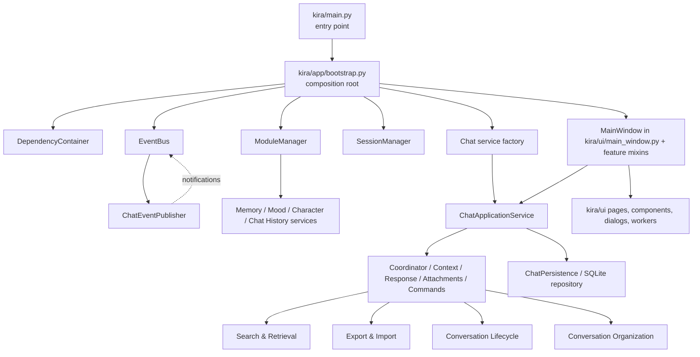
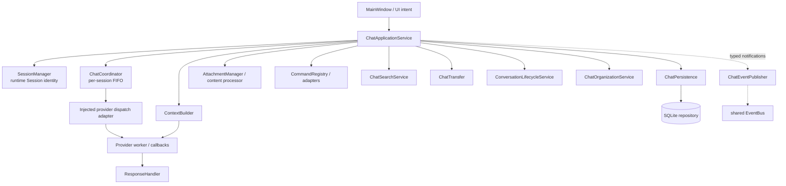
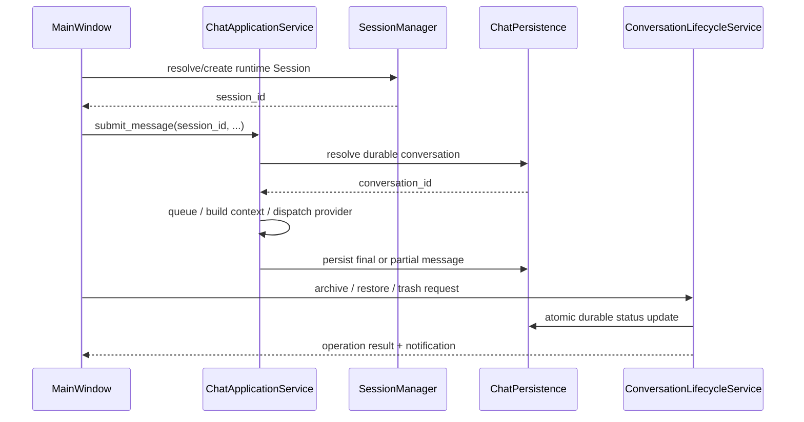

# KIRA ARCHITECTURE MASTER ROADMAP

**Snapshot date:** 2026-11-18  
**Repository:** `alizesta/Kira`  
**Base branch:** `new-main`  
**Source baseline SHA:** `e398ed518ef446600ef758288f1dca2803845d98`  
**Evidence:** TASK 015 static audit (`docs/TASK_015_FINAL_ARCHITECTURE_AUDIT.md`, Draft PR #47), current `new-main` source and documentation, and merged TASK 013+014 integration PR #48 (merge commit `b54d092a330b6383ca4244320ffaeec9267db561`).  
**Verification boundary:** Source and static wiring checks were reviewed. Focused tests and compile checks were added to GitHub Actions, but inspected jobs completed with `runner_id=0`, no steps and unavailable logs. No Python test, import, compile or desktop runtime pass is claimed.

> This document is the current architecture entry point. It distinguishes the repository state observed at this snapshot from the desired migration direction. A planned boundary is not evidence that the boundary is already implemented.

## 1. Executive architecture summary

Kira is an incremental modularization of a PySide6 desktop application. The Python entry point is thin and delegates startup to `kira.app.bootstrap`. Bootstrap is the composition root and constructs the dependency container, shared EventBus, typed Chat event publisher, ModuleManager, required service modules, SessionManager, Chat and Session application-service factories, and the injected Web Search, Voice, Game Mode, Provider, Vision, Coding Agent and Runtime Settings application services. The production window lives in `kira.ui.main_window.MainWindow`, with feature-oriented mixins under `kira/ui/main_window_*.py` and scoped dependency modules. The legacy `kira/oldmain.py` file has been removed. `MainWindow` now acts as a compact Qt host: widget/service assembly is delegated to `kira.ui.main_window_composition.initialize_main_window`, while the class retains the feature mixins and their state descriptors. Chat and Voice application composition no longer accepts a concrete MainWindow; typed callback/device contracts live in `kira/core/interfaces/application_ports.py`, and UI adapters construct those ports in `kira/ui/application_adapters.py`. This removes the direct application-composition dependency on the window class. It does not claim that all feature policy has left the mixins; remaining policy and cross-feature orchestration debt is tracked below.

The Chat domain is the most clearly separated feature area. All fourteen Chat task modules are present on `new-main` after PR #48 merged TASK 013 and TASK 014 together. The Chat core services are designed to be Qt-free and communicate through injected contracts. Persistence remains the durable storage boundary. Runtime Session state is separate from durable Conversation state. The EventBus broadcasts notifications; it is not a general-purpose service-call router. ToolAgent's transient caches, permission taint/grants, confirmations, cancellation and task-control bookkeeping are isolated by character Session. WebIntel's resumable research data is persisted in a per-character namespace, and its process-wide worker cancellation facade is activated for only one serialized research owner at a time. Brain reply hints, turn counters and Reflection rate limits are also per character; the legacy Kira brain file remains backward-compatible, while the optional Memory Writer cursor remains global to the shared history stream.

The generic ModuleManager and DependencyContainer exist and are used by bootstrap, but only the Memory, Mood, Character Profile and Chat History service modules are registered there today. Chat, Voice, Avatar, Web Research, Coding Agent, Provider, Vision and Runtime Settings capabilities are not independently lifecycle-managed feature modules. The application services are injected directly; they are not ModuleManager lifecycle modules.

## 2. Evidence and status interpretation

TASK 015 audited TASK 001–014 against `new-main` at `b5d386fac1423b1b0cd07199426aef4f214e4d97`. Its final recorded counts were **12 DONE / 2 PARTIAL / 0 NOT DONE / 0 BLOCKED / 0 UNVERIFIED**, with a decision of **NOT READY FOR TESTING**. TASK 010 was corrected to DONE after its production wiring was traced through `MainWindow.__init__ → _install_chat_commands() → ChatApplicationService.set_command_registry()`.

At the audit snapshot, TASK 013 and TASK 014 were PARTIAL because their branches had not yet reached `new-main`. They were subsequently integrated together by merged PR #48. The current `new-main` HEAD is the merge commit above, and the two modules and their shared event/public exports are present in the current tree. This is a post-audit integration delta; it does **not** rewrite the historical TASK 015 counts or constitute runtime acceptance.

The original NOT READY FOR TESTING decision is retained as the historical audit result. The PR merge resolves its stated integration blocker. The subsequent source delta implements the missing Session application orchestration and the main Provider/Vision/Coding Agent/Runtime Settings/Character policy boundaries on `new-main`; this updates source status only, not runtime acceptance. No test or compile pass is claimed because GitHub Actions did not assign a runner.

Status labels in this document:
- **Implemented / statically present:** source and contracts exist in the inspected branch.
- **Partial:** an implementation exists, but a stated integration or architecture boundary is incomplete.
- **Not established:** no implementation was confirmed in the inspected source; do not infer it from a roadmap item.
- **Runtime unverified:** static evidence is insufficient to claim behavior under real execution.

## 3. High-level architecture

The diagram is a bounded view of the production startup and Chat composition. It does not imply that every capability in the repository is registered with ModuleManager or that all MainWindow policy has moved into services.

### 3.1 Application entry and composition

| Element | Current responsibility | Status / boundary |
|---|---|---|
| `kira/main.py` | Exposes `main()`, imports and calls `run_application()`; retains a lazy compatibility export of `MainWindow` from `kira.ui.main_window`. | Implemented thin entry point; compatibility export remains. |
| `kira/app/bootstrap.py` | Creates QApplication, dependency container, EventBus, ChatEventPublisher, ModuleManager, required services, SessionManager, Chat and Session factories, Provider/Vision/Coding Agent/Runtime Settings services, WebSearch/Voice/Game Mode services and MainWindow; connects shutdown. | Actual Composition Root. |
| `kira/app/dependency_container.py` | Instance/factory registration, lazy resolution and unregister. | Implemented; explicit DI container, not proof that every dependency uses it. |
| `kira/app/module_manager.py` | Module registration, dependency ordering, start/stop/enable/disable/unregister/dispose and failure isolation. | Implemented engine; feature registration is partial. |
| `kira/app/event_bus.py` | In-process publish/subscribe notifications and typed event delivery support. | One shared application bus. |
| `kira/ui/main_window.py` + `main_window_composition.py` + `main_window_*.py` | Compact Qt host, extracted widget/service assembly, and feature-oriented UI behavior mixins. | Composition is separated from the host; feature policy still remains in some mixins. |

Bootstrap currently registers required service modules for Memory, Mood, Characters and Chat History. It starts them before constructing the window, injects their resolved services and retains the container, bus, publisher, SessionManager and ModuleManager on the window for application lifetime. The Chat factory is created with the resolved Chat History persistence adapter and shared ChatEventPublisher; the Session factory shares the publisher and is injected with SessionManager plus ChatApplicationService. `WebSearchApplicationService` is injected into MainWindow and owns search-provider/query/request/evidence policy. `VoiceApplicationService` is injected through a factory and owns microphone worker lifecycle, speech/stream/file-playback delegation and wake/sleep/stop transcript decisions. `GameModeApplicationService` owns capability permissions, command restrictions, and game-audio alert classification/cooldowns. Speaker and Listener remain injected device adapters; Qt signals and UI presentation remain at the UI boundary.

### 3.2 Capability inventory

| Capability | Current source/owner evidence | Current status |
|---|---|---|
| Chat | `kira/chat/*`, `kira/app/chat_composition.py` | Fourteen task boundaries statically present; see module matrix. Runtime not verified. |
| Persistence | `kira/chat/persistence.py`, Chat History service adapter, existing SQLite storage | Chat durable storage boundary exists. Other legacy stores still exist; do not assume all application data has migrated here. |
| Characters | `kira/services/character_service.py`, `kira/characters`, CharactersPage | CharacterProfileService owns profile create/update/delete, preference/resource normalization and personality mutation; UI renders forms and coordinates Qt pages/session changes. |
| Memory | `kira/services`, `kira/persona_memory.py`, `kira/evidence_memory.py`, `kira/memory.py` | Service-backed and registered in bootstrap; legacy compatibility modules remain. |
| Voice | `kira/core/interfaces/voice_service.py`, `kira/app/voice_application.py`, `kira/app/voice_composition.py`, `kira/voice.py`, `kira/listener.py`, `kira/local_voice.py` | `VoiceApplicationService` implements the VoiceService contract; owns microphone lifecycle, speech/stream/file playback delegation and wake/sleep/stop transcript policy. Speaker/Listener are injected device adapters; Qt signal relay and presentation remain in MainWindow. |
| Avatar & emotion | `kira/face.py`, `kira/vrm_avatar.py`, `kira/companion.py`, `kira/emotion/*`, `kira/body.py`, `kira/rig.py` | Rendering/emotion capability exists; not an independently managed application module. |
| Tools & commands | `kira/tools/*`, `kira/actions.py`, `kira/chat/commands.py`, `kira/chat/command_adapters.py` | Chat command registry/adapter contracts exist and are installed by MainWindow; general tool execution remains in capability/legacy integration code. |
| Coding Agent | `kira/app/coding_agent_application.py`, `kira/chat_code.py`, `kira/auto_agent.py`, `kira/code_agent.py` | CodingAgentApplicationService owns eligible handoff, attachment bypass and stop delegation; the existing execution engine and its UI/worker adapters remain separate. It is not a ModuleManager feature module. |
| Game Mode & game audio | `kira/app/game_mode_application.py`, `kira/game_audio_policy.py`, `kira/game_mode_policy.py`, `kira/game_audio.py` | `GameModeApplicationService` owns profile permissions, command restrictions and game-audio alert/cooldown policy; the loopback worker remains a Qt/device adapter. |
| Web Research | `kira/app/web_search.py`, `kira/websearch.py`, `kira/webintel/*`, discovery/search adapters | `WebSearchApplicationService` owns provider credentials, follow-up rewriting, web/image options and evidence merging. SearchWorker lifecycle and result presentation remain in the UI adapter. |
| Vision | `kira/app/vision_application.py`, `kira/vision_pipeline.py`, `kira/vision_ocr.py` | VisionApplicationService owns capture eligibility, cadence/frame gating, duplicate-result suppression and result policy; Qt screen capture, timers and workers remain UI adapters. It is injected directly, not ModuleManager-managed. |
| UI | `kira/ui/pages`, `components`, `dialogs`, `workers.py`, `main_window.py`, `main_window_composition.py` and feature mixins | MainWindow is a compact Qt host. Session, Provider, Vision, Coding Agent, Runtime Settings and Character profile policy are delegated to application/service owners; Qt widget state, worker/timer lifecycle, dialog flows and response rendering remain in feature adapters. |
| Shared Skills | No first-party shared Skills module/contract was established by TASK 015's TASK 001–014 audit or the inspected `kira/` package tree on this base. | Do not claim shared installable Skills are delivered by these Chat tasks. Treat a separately merged Skills implementation as separate evidence. |

## 4. Chat architecture

The fourteen Chat modules and their public contracts are indexed in [MODULE_OWNERSHIP.md](MODULE_OWNERSHIP.md). Their intended production flow is:

The flow is conceptual at the public-contract level: MainWindow adapts provider callbacks and owns worker/UI presentation. Web Search eligibility, query planning, command parsing, diagnostics, provider/request/evidence formatting policy is delegated to `WebSearchApplicationService`; microphone lifecycle and transcript policy are delegated to `VoiceApplicationService`; Game Mode permission and alert policy are delegated to `GameModeApplicationService`. Device construction, Qt signal relay and presentation remain in the UI adapter. Each feature mixin imports its scoped dependency module; the shared support module contains only cross-feature relays and helpers. The direct request/response path uses service calls and injected callbacks. EventBus is for notification, not to invoke another module's business API.

### 3.1 Dependency direction contracts

The module lifecycle and event contracts now live in `kira/core/interfaces/application_module.py`: structural `DependencyRegistry`, `ModuleEventBus`, `PublishedEvent` and `EventPublicationReport` ports. Core no longer imports concrete `kira.app` implementations, even under `TYPE_CHECKING`. `ModuleManager` and `ServiceModule` use the Core lifecycle ports; `ChatEventPublisher` depends on `ModuleEventBus`; and the shared `EventBus` validates/publishes the generic event envelope without importing `kira.chat`. The Qt-free `tests/test_architecture_boundaries.py` suite checks these directions, including that Chat UI does not import the Web Search engine module, and is included in the portable test lists, but has not been run in this environment.

### 4.1 Identity and lifecycle boundaries

- **Request:** one logical user turn, identified by `request_id`.
- **Runtime Session:** live interaction state, owned by `SessionManager`; scoped to a character and independent of durable Conversation storage.
- **Conversation:** durable history identity and state, owned by persistence plus Conversation Lifecycle policy.
- **Character:** identity/profile scope carried into context construction and durable conversation records. Chat feature modules accept character/session/conversation identifiers rather than hard-coding Kira behavior.

SessionManager must not become a second owner of Conversation persistence. Conversation Lifecycle must not become a second owner of runtime Session state.

### 4.2 Persistence boundary

`ChatPersistence` / `SqliteChatRepository` owns Chat schema, transactions, recovery, conversation/message reads and writes. Chat services consume its facade/Protocol. Search reads through the injected message cursor; Transfer delegates import writes to the repository transaction boundary; Lifecycle delegates durable state transitions and guarded deletion to persistence; Organization updates the existing conversation metadata document through the persistence API. None of those feature services opens a second database or writes SQL directly.

The AD-03/AD-04 source-level limitations are now addressed: Organization applies mutations to the latest row inside a SQLite write transaction; character-scoped tag/folder bulk changes execute in one atomic transaction. `mutate_conversations` and `mutate_all_conversations` preserve unrelated metadata keys and leave lifecycle status under its dedicated transaction API. Focused tests cover concurrent repository instances and rollback after a mid-batch failure; those tests have not yet been executed.

## 5. Event and notification policy

Bootstrap creates one shared, feature-neutral `EventBus`. The bus accepts the Core `PublishedEvent` envelope and does not import any feature package. `ChatEventPublisher` implements the Chat notification contract over the Core `ModuleEventBus` port and creates immutable typed events for request/stream/session/command lifecycles, Conversation Lifecycle and Organization metadata updates. Session lifecycle orchestration now uses `SessionApplicationService` for initial activation, conversation binding, profile synchronization, pending-work checks, state-event translation and disposal; SessionManager remains the runtime state engine. Provider route/API settings, runtime route inspection/manual selection and router replacement use `ProviderApplicationService`; Vision capture policy uses `VisionApplicationService`; Coding Agent interception uses `CodingAgentApplicationService`; runtime-wide consumer updates use `RuntimeSettingsApplicationService`; Character profile mutations use `CharacterProfileService`. Chat UI interacts with `WebSearchApplicationService` for planning, command parsing, diagnostics and evidence formatting; it no longer imports `kira.websearch` directly. Qt resources, worker/timer objects, widget state and result rendering remain UI adapter responsibilities.

Use direct injected service methods for request/response and business operations. Publish events after state changes when observers need notification. Do not use EventBus as a universal dependency locator, RPC bus or substitute for a result-returning API.

## 6. Character independence

Static contracts support a character-neutral Chat core:
- ContextBuilder accepts character ID/profile and supplied context as request data; it does not select a persona itself.
- SessionManager maps character/session identity for runtime interactions.
- Chat request/event contracts retain request and session IDs.
- Persistence/history APIs carry character and conversation scope.
- The audited Chat core does not hard-code Kira persona behavior; `DEFAULT_CHARACTER = "kira"` is a compatibility default.

This is static architecture evidence, not proof of isolation across concurrent Kira/Ren/Mika sessions, restarts, search, transfer or memory. Those behaviors remain runtime acceptance items. A future shared Skills/Tools capability must be character-neutral; character-specific instructions and enablement preferences belong in character/profile configuration, not inside generic command handlers.

## 7. MainWindow and legacy migration

The actual production window is imported by bootstrap from `kira.ui.main_window.MainWindow` (PR #55, merge commit `101361f60bb19a45484cbcdb7b52584eb3da0111`). The 5,634-line legacy module has been removed after its 322 MainWindow methods were moved into eight feature-oriented mixins (session/navigation, voice settings, character settings, provider settings, window lifecycle, attachments/vision, Chat/Web Research, and runtime/voice). Shared imports and Qt relay support live in `main_window_support.py`. The window's 250+ line initialization sequence is now owned by `main_window_composition.py`; `main_window.py` is a compact Qt host with only shell imports, state descriptors, feature mixins and a delegating constructor. Chat and Voice application factories receive typed `ChatApplicationPorts` / `VoiceApplicationPorts` from the UI adapter instead of receiving the MainWindow object. `kira.main` retains only a lazy compatibility export to the UI package. The principal application-policy boundaries are now injected services; remaining mixin responsibilities are primarily Qt-facing orchestration, worker/resource lifecycle, dialogs, command/attachment UI flow and rendering.

Target boundary:
1. `kira/main.py` remains a small entry point.
2. `kira/app/bootstrap.py` remains the only production Composition Root.
3. MainWindow hosts pages, translates UI intents and renders state.
4. Feature policy and orchestration move behind application services/controllers.
5. Compatibility exports/fallback construction are removed only after call sites migrate.

No code migration is part of TASK 016.

## 8. Technical debt and next steps

See [ARCHITECTURE_ROADMAP.md](ARCHITECTURE_ROADMAP.md) and [MODULE_OWNERSHIP.md](MODULE_OWNERSHIP.md) for the updated debt register and service contracts. Chat command dispatch, attachment lifecycle/content preparation and fallback payload composition are owned by ChatApplicationService, CommandRegistry and AttachmentManager. ToolAgent/AccessManager temporary state, WebIntel research/cancellation and Brain reply-hint/Reflection state are character-session scoped; Session close releases ephemeral caches and permissions without deleting resumable task/research files. Task history retention is per character. The optional Brain Memory Writer remains a single shared-history process. Remaining source work is UI request sequencing, Qt worker/widget lifecycle, dialogs and rendering; these remain UI adapter responsibilities. The application service/factory graph is registered through ModuleManager with explicit Chat History → Chat Application → Session Application and Game Mode → Vision dependencies. Qt-bound workers and per-window Chat/Session/Voice instances retain the window-owned graceful shutdown path. Runtime acceptance for the new services and existing Chat flows remains outstanding.

The implementation and verification evidence is summarized in [ARCHITECTURE_IMPLEMENTATION_HANDOFF_2026-11-18.md](ARCHITECTURE_IMPLEMENTATION_HANDOFF_2026-11-18.md).

## 9. Related documents

- [Module ownership and public contracts](MODULE_OWNERSHIP.md)
- [Architecture roadmap and debt register](ARCHITECTURE_ROADMAP.md)
- [TASK 015 audit report](https://github.com/alizesta/Kira/pull/47) (Draft PR; report remains on its audit branch)
- [Chat Application Service](CHAT_APPLICATION_SERVICE.md)
- [Chat Conversation Lifecycle](CHAT_CONVERSATION_LIFECYCLE.md)
- [Chat Organization](CHAT_ORGANIZATION.md)
- [Chat Search & Retrieval](CHAT_SEARCH_RETRIEVAL.md)
- [Chat Transfer](CHAT_TRANSFER.md)
- [Chat Events](CHAT_EVENTS.md)
