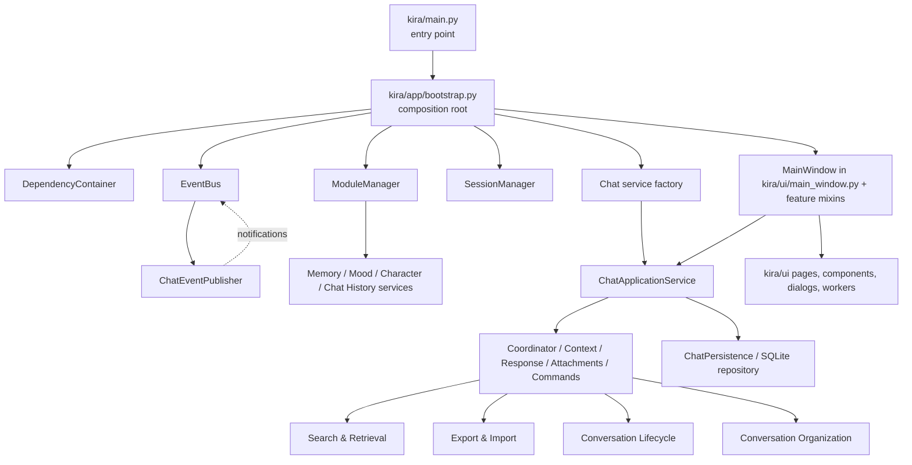
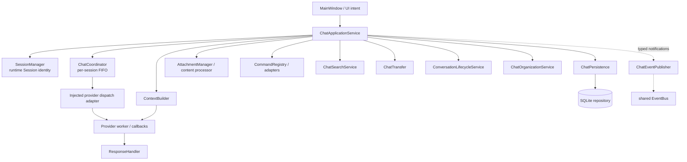
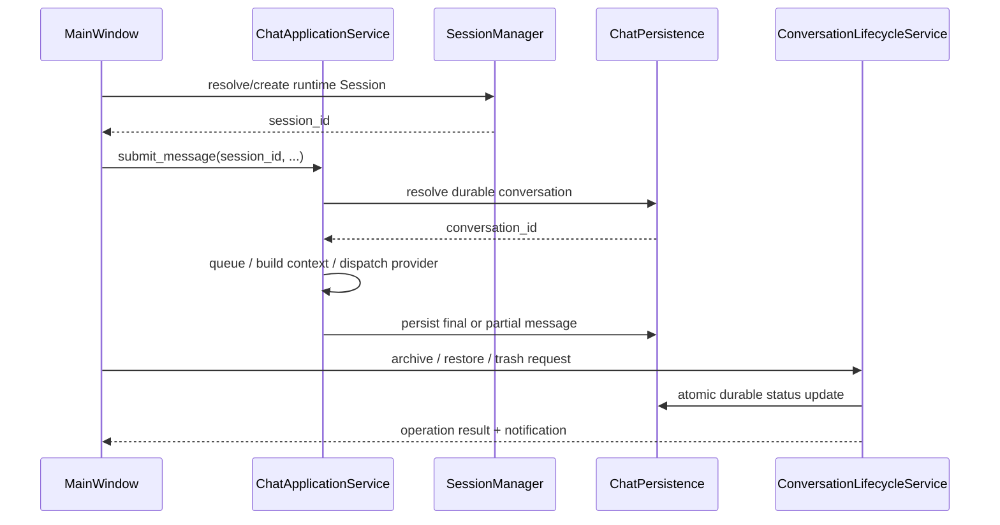

# KIRA ARCHITECTURE MASTER ROADMAP

**Snapshot date:** 2026-11-18  
**Repository:** `alizesta/Kira`  
**Base branch:** `new-main`  
**Base SHA:** `516765f0ceca9b674f32bec2d6491bf82b2e434f`  
**Evidence:** TASK 015 static audit (`docs/TASK_015_FINAL_ARCHITECTURE_AUDIT.md`, Draft PR #47), current `new-main` source and documentation, and merged TASK 013+014 integration PR #48 (merge commit `b54d092a330b6383ca4244320ffaeec9267db561`).  
**Verification boundary:** static inspection only. No tests, compile/import checks, application execution, Windows checks or GUI checks were run for TASK 016.

> This document is the current architecture entry point. It distinguishes the repository state observed at this snapshot from the desired migration direction. A planned boundary is not evidence that the boundary is already implemented.

## 1. Executive architecture summary

Kira is an incremental modularization of a PySide6 desktop application. The Python entry point is now thin and delegates startup to `kira.app.bootstrap`. Bootstrap is the composition root and constructs the dependency container, shared EventBus, typed Chat event publisher, ModuleManager, required service modules, SessionManager, Chat application-service factory, and injected Session, Web Search, Voice, Game Mode, Provider, Vision, Coding Agent and Runtime Settings application services. The production window now lives in `kira.ui.main_window.MainWindow` and its feature-oriented mixins under `kira/ui/main_window_*.py`. The legacy `kira/oldmain.py` file has been removed. The window is decomposed by UI capability, but substantial application policy and cross-feature orchestration still remain in those mixins; it is **not yet a thin presentation shell**.

The Chat domain is the most clearly separated feature area. All fourteen Chat task modules are present on `new-main` after PR #48 merged TASK 013 and TASK 014 together. The Chat core services are designed to be Qt-free and communicate through injected contracts. Persistence remains the durable storage boundary. Runtime Session state is separate from durable Conversation state. The EventBus broadcasts notifications; it is not a general-purpose service-call router.

The generic ModuleManager and DependencyContainer exist and are used by bootstrap, but only the Memory, Mood, Character Profile and Chat History service modules are registered there today. Chat, Voice, Avatar, Web Research, Coding Agent and Provider capabilities are not yet independently lifecycle-managed feature modules. Provider, Vision and Coding Agent policy is injected directly through the composition root; this is separate from ModuleManager registration.

## 2. Evidence and status interpretation

TASK 015 audited TASK 001–014 against `new-main` at `b5d386fac1423b1b0cd07199426aef4f214e4d97`. Its final recorded counts were **12 DONE / 2 PARTIAL / 0 NOT DONE / 0 BLOCKED / 0 UNVERIFIED**, with a decision of **NOT READY FOR TESTING**. TASK 010 was corrected to DONE after its production wiring was traced through `MainWindow.__init__ → _install_chat_commands() → ChatApplicationService.set_command_registry()`.

At the audit snapshot, TASK 013 and TASK 014 were PARTIAL because their branches had not yet reached `new-main`. They were subsequently integrated together by merged PR #48. The current `new-main` HEAD is the merge commit above, and the two modules and their shared event/public exports are present in the current tree. This is a post-audit integration delta; it does **not** rewrite the historical TASK 015 counts or constitute runtime acceptance.

The original NOT READY FOR TESTING decision is retained as the historical audit result. PR #56 carries the TASK 017–020 extraction sequence: Session, Web Search, Voice, Game Mode and feature-scoped UI dependencies. PR #57 completes the remaining Provider, Vision and Coding Agent policy boundaries. MainWindow still owns Qt presentation/device adapters and character settings workflows; provider forms/catalog presentation also remain UI-side. Neither PR has passed runtime acceptance: GitHub Actions jobs have failed before runner allocation, so no test or compile PASS is claimed.

Status labels in this document:
- **Implemented / statically present:** source and contracts exist in the inspected branch.
- **Partial:** an implementation exists, but a stated integration or architecture boundary is incomplete.
- **Not established:** no implementation was confirmed in the inspected source; do not infer it from a roadmap item.
- **Runtime unverified:** static evidence is insufficient to claim behavior under real execution.

## 3. High-level architecture

The diagram is a bounded view of the production startup and Chat composition. It does not imply that every capability in the repository is registered with ModuleManager or that all MainWindow policy has moved into services.

### 3.1 Application entry and composition

| Element | Current responsibility | Status / boundary |
|---|---|---|
| `kira/main.py` | Exposes `main()`, imports and calls `run_application()`; retains a lazy compatibility export of `MainWindow` from `kira.ui.main_window`. | Implemented thin entry point; compatibility export remains. |
| `kira/app/bootstrap.py` | Creates QApplication, dependency container, EventBus, ChatEventPublisher, ModuleManager, required services, SessionManager, Chat factory, Session/Web Search/Voice/Game Mode/Provider/Vision/Coding Agent/Runtime Settings application services, ToolAgent and MainWindow; connects shutdown. | Actual Composition Root. |
| `kira/app/dependency_container.py` | Instance/factory registration, lazy resolution and unregister. | Implemented; explicit DI container, not proof that every dependency uses it. |
| `kira/app/module_manager.py` | Module registration, dependency ordering, start/stop/enable/disable/unregister/dispose and failure isolation. | Implemented engine; feature registration is partial. |
| `kira/app/event_bus.py` | In-process publish/subscribe notifications and typed event delivery support. | One shared application bus. |
| `kira/ui/main_window.py` + `main_window_*.py` | MainWindow composition plus feature-oriented UI behavior mixins and scoped dependency modules. | Active production UI adapter; Session, Web Search, Voice, Game Mode, Provider, Vision and Coding Agent policy crosses injected service boundaries. Character settings, Qt/device capture, workers and result presentation remain UI adapters. |

Bootstrap currently registers required service modules for Memory, Mood, Characters and Chat History. It starts them before constructing the window, injects their resolved services and retains the container, bus, publisher, SessionManager and ModuleManager on the window for application lifetime. The Chat factory is created with the resolved Chat History persistence adapter and shared ChatEventPublisher.

### 3.2 Capability inventory

| Capability | Current source/owner evidence | Current status |
|---|---|---|
| Chat | `kira/chat/*`, `kira/app/chat_composition.py` | Fourteen task boundaries statically present; see module matrix. Runtime not verified. |
| Persistence | `kira/chat/persistence.py`, Chat History service adapter, existing SQLite storage | Chat durable storage boundary exists. Other legacy stores still exist; do not assume all application data has migrated here. |
| Characters | `kira/services`, `kira/character`, `kira/characters`, `kira/personality.py`, CharactersPage | Profile/service separation exists; MainWindow still owns switching and other application behavior. |
| Memory | `kira/services`, `kira/persona_memory.py`, `kira/evidence_memory.py`, `kira/memory.py` | Service-backed and registered in bootstrap; legacy compatibility modules remain. |
| Voice | `kira/core/interfaces/voice_service.py`, `kira/app/voice_application.py`, `kira/voice.py`, `kira/listener.py`, `kira/local_voice.py` | `VoiceApplicationService` implements the VoiceService contract and owns microphone lifecycle, playback/stream delegation and wake/sleep/stop transcript policy. Speaker/Listener remain injected device/Qt adapters. |
| Avatar & emotion | `kira/face.py`, `kira/vrm_avatar.py`, `kira/companion.py`, `kira/emotion/*`, `kira/body.py`, `kira/rig.py` | Rendering/emotion capability exists; not an independently managed application module. |
| Tools & commands | `kira/tools/*`, `kira/actions.py`, `kira/chat/commands.py`, `kira/chat/command_adapters.py` | Chat command registry/adapter contracts exist and are installed by MainWindow; general tool execution remains in capability/legacy integration code. |
| Coding Agent | `kira/auto_agent.py`, `kira/code_agent.py`, `kira/chat_code.py`, `kira/chat_code_ui.py`, `kira/app/coding_agent_application.py` | CodingAgentApplicationService owns attachment-free turn interception, local Chat request completion and stop delegation; agent runtime remains the capability owner and is not a separately registered ModuleManager feature module. |
| Web Research | `kira/app/web_search.py`, `kira/websearch.py`, `kira/webintel/*`, discovery/search adapters | `WebSearchApplicationService` owns provider credential selection, query rewriting, search options and evidence normalization; SearchWorker creation and result presentation remain at the UI boundary. |
| Provider | `kira/app/provider_application.py`, `kira/routes.py`, `kira/api_manager.py`, `kira/hybrid_ai.py` | ProviderApplicationService owns route/provider settings policy, API registry mutations, Ollama URL validation, router creation/rebuild and Ollama client construction; widgets remain UI-side. |
| Runtime settings | `kira/app/runtime_settings_application.py`, `kira/usage.py`, `kira/evidence_memory.py` | RuntimeSettingsApplicationService owns shared usage-ledger/evidence-memory initialization and reconfiguration; UI delegates saved settings snapshots and ToolAgent updates. |
| Vision | `kira/app/vision_application.py`, `kira/vision_pipeline.py`, `kira/vision_ocr.py`, game detection/mode/audio modules | VisionApplicationService owns frame cadence, capture eligibility, contention checks, result deduplication and latency policy; Qt capture/encoding/workers remain UI-side. |
| UI | `kira/ui/pages`, `components`, `dialogs`, `workers.py`, `main_window.py` and feature mixins | Several pages/components/workers extracted; MainWindow remains a large UI/application adapter. |
| Shared Skills | No first-party shared Skills module/contract was established by TASK 015's TASK 001–014 audit or the inspected `kira/` package tree on this base. | Do not claim shared installable Skills are delivered by these Chat tasks. Treat a separately merged Skills implementation as separate evidence. |

## 4. Chat architecture

The fourteen Chat modules and their public contracts are indexed in [MODULE_OWNERSHIP.md](MODULE_OWNERSHIP.md). Their intended production flow is:

The flow is conceptual at the public-contract level: MainWindow still adapts provider callbacks and owns widget/device presentation. Session, Web Search, Voice and Game Mode policy now cross injected application-service boundaries. EventBus is for notification, not to invoke another module's business API.

### 4.1 Identity and lifecycle boundaries

- **Request:** one logical user turn, identified by `request_id`.
- **Runtime Session:** live interaction state, owned by `SessionManager`; scoped to a character and independent of durable Conversation storage.
- **Conversation:** durable history identity and state, owned by persistence plus Conversation Lifecycle policy.
- **Character:** identity/profile scope carried into context construction and durable conversation records. Chat feature modules accept character/session/conversation identifiers rather than hard-coding Kira behavior.

SessionManager must not become a second owner of Conversation persistence. Conversation Lifecycle must not become a second owner of runtime Session state.

### 4.2 Persistence boundary

`ChatPersistence` / `SqliteChatRepository` owns Chat schema, transactions, recovery, conversation/message reads and writes. Chat services consume its facade/Protocol. Search reads through the injected message cursor; Transfer delegates import writes to the repository transaction boundary; Lifecycle delegates durable state transitions and guarded deletion to persistence; Organization updates the existing conversation metadata document through the persistence API. None of those feature services opens a second database or writes SQL directly.

Known persistence limitations are recorded in the roadmap and ownership register: Organization currently updates whole metadata documents, so independent writers can race; bulk tag/folder deletion updates conversations individually and is not a cross-conversation atomic transaction.

## 5. Event and notification policy

The application has one EventBus instance created by bootstrap. `ChatEventPublisher` creates immutable typed Chat events and publishes them through that shared bus. The typed contract includes request/stream/session/command lifecycle events and the TASK 013 lifecycle plus TASK 014 metadata notifications. The publisher owns notification construction and terminal-notification de-duplication only; it does not own request, Session, Conversation or persistence state.

Use direct injected service methods for request/response and business operations. Publish events after state changes when observers need notification. Do not use EventBus as a universal dependency locator, RPC bus or substitute for a result-returning API.

## 6. Character independence

Static contracts support a character-neutral Chat core:
- ContextBuilder accepts character ID/profile and supplied context as request data; it does not select a persona itself.
- SessionManager maps character/session identity for runtime interactions.
- Chat request/event contracts retain request and session IDs.
- Persistence/history APIs carry character and conversation scope.
- The audited Chat core does not hard-code Kira persona behavior; `DEFAULT_CHARACTER = "kira"` is a compatibility default.

This is static architecture evidence, not proof of isolation across concurrent Kira/Ren/Mika sessions, restarts, search, transfer or memory. Those behaviors remain runtime acceptance items. A future shared Skills/Tools capability must be character-neutral; character-specific instructions and enablement preferences belong in character/profile configuration, not inside generic command handlers.

## 7. MainWindow and legacy migration

The actual production window is imported by bootstrap from `kira.ui.main_window.MainWindow`. The 5,634-line legacy module has been removed after its 322 MainWindow methods were moved into eight feature-oriented mixins (session/navigation, voice settings, character settings, provider settings, window lifecycle, attachments/vision, Chat/Web Research, and runtime/voice). Shared imports and Qt relay support live in `main_window_support.py`. `kira.main` retains only a lazy compatibility export to the new UI package. TASK 020 completion adds injected Provider, Vision and Coding Agent services: provider route/config policy, vision cadence/capture policy, Coding Agent handoff/stop and shared runtime settings reconfiguration no longer live in the UI mixins. Qt capture, widgets, workers, presentation and character settings remain UI responsibilities; MainWindow is still not a zero-logic shell.

Target boundary:
1. `kira/main.py` remains a small entry point.
2. `kira/app/bootstrap.py` remains the only production Composition Root.
3. MainWindow hosts pages, translates UI intents and renders state.
4. Feature policy and orchestration move behind application services/controllers.
5. Compatibility exports/fallback construction are removed only after call sites migrate.

No code migration is part of TASK 016.

## 8. Technical debt and next steps

See [ARCHITECTURE_ROADMAP.md](ARCHITECTURE_ROADMAP.md) for the prioritized debt register and evidence-based phases. The most important confirmed debt is the remaining application-policy coupling inside MainWindow's feature mixins. The Organization persistence limitations are confirmed by its own contract documentation. Runtime isolation, concurrency, event delivery and lifecycle behavior are unverified, not confirmed defects.

## 9. Related documents

- [Module ownership and public contracts](MODULE_OWNERSHIP.md)
- [Architecture roadmap and debt register](ARCHITECTURE_ROADMAP.md)
- [TASK 015 audit report](https://github.com/alizesta/Kira/pull/47) (Draft PR; report remains on its audit branch)
- [Chat Application Service](CHAT_APPLICATION_SERVICE.md)
- [Chat Conversation Lifecycle](CHAT_CONVERSATION_LIFECYCLE.md)
- [Chat Organization](CHAT_ORGANIZATION.md)
- [Chat Search & Retrieval](CHAT_SEARCH_RETRIEVAL.md)
- [Chat Transfer](CHAT_TRANSFER.md)
- [Chat Events](CHAT_EVENTS.md)
