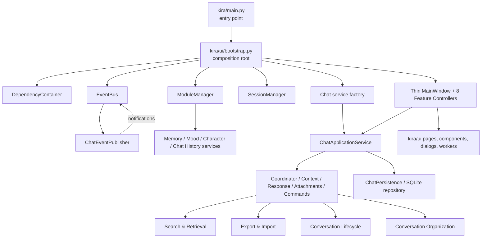
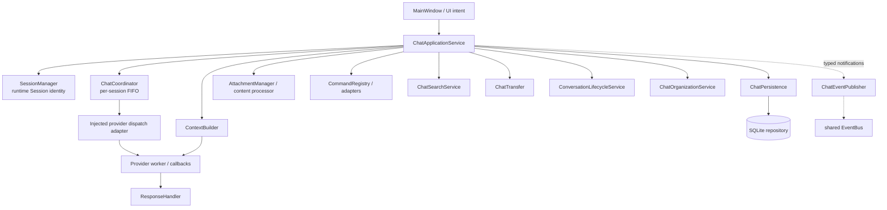
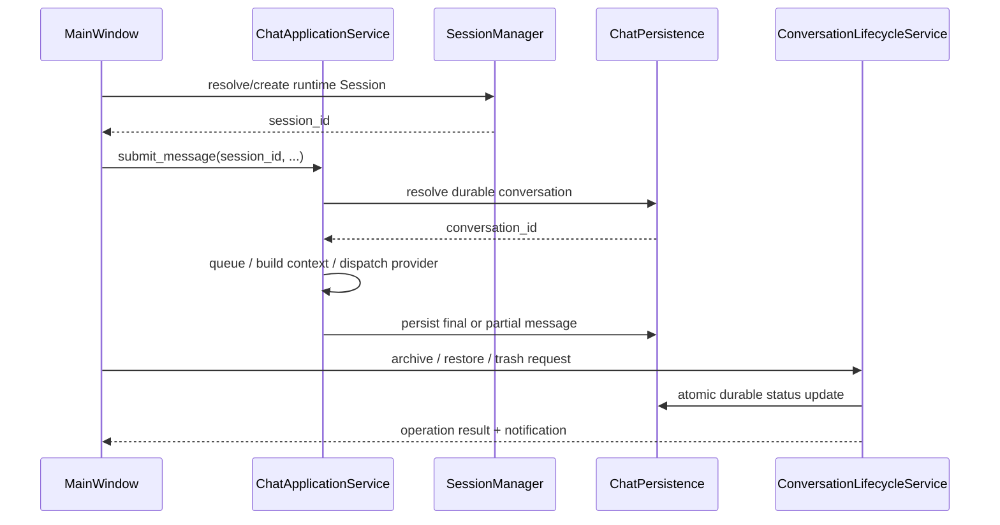

# KIRA ARCHITECTURE MASTER ROADMAP

**Snapshot date:** 2026-11-19  
**Current synchronization:** 2026-11-23; source baseline `new-main` at `91d5cdad7359da1d8bb626064fa84d676c160c02`. Historical audit dates and counts below remain unchanged.  
**Merged architecture deltas:** PRs #239 (startup deferral), #240 (topic-scoped tool schemas), #243 (inactive Session/service deferral), and #246 (Chat/UI import boundaries, history facade and SQLite schema manager) are merged into `new-main`.  
**Pending acceptance:** PR #248 (idle avatar/render and worker-import optimization) and PR #250 (lazy voice settings toggle guard) are open at this snapshot. Their tests and Windows runtime/CPU/memory measurements are not yet accepted. Workflow jobs with empty step lists are infrastructure failures, not test passes.
**Repository:** `alizesta/Kira`  
**Base branch:** `new-main`  
**Source baseline SHA:** `0a84bbdc3d47afb1728ff314a056b49e6e56848b`  
**Evidence:** TASK 015 historical static audit; merged TASK 013+014 integration PR #48; TASK 017–020 source work and handoff; current `new-main` source at the baseline SHA; and merged PR #98 (merge commit `0a84bbdc3d47afb1728ff314a056b49e6e56848b`) correcting stale Chat event test contracts and CI path filters.  
**Verification boundary:** Source and documentation were statically inspected. PR #98 merged the stale Chat event test-path/assertion fixes and added the test file to the lifecycle workflow path filter. Its GitHub Actions jobs still completed without an assigned runner (`runner_id=0`, `steps=[]`) and logs were unavailable (`BlobNotFound`). No Python test, import, compile or desktop runtime pass is claimed from those jobs.

> This is the canonical detailed architecture reference, linked from the root `ARCHITECTURE.md` index. It distinguishes the repository state observed at this snapshot from the desired migration direction. A planned boundary is not evidence that the boundary is already implemented.

## 1. Executive architecture summary

Kira is a modular-monolith PySide6 desktop application. The Python entry point (`kira/main.py`) delegates to the single production Composition Root (`kira/ui/bootstrap.py`), which constructs the dependency container, shared EventBus, typed Chat event publisher and ModuleManager, registers the application service/factory graph through `kira/app/feature_modules.py`, and injects those services into the desktop composition. The application and Chat layers remain toolkit-independent; Qt worker/signal/device translation lives in `kira/ui/application_adapters.py`, behind explicit ports. The production window is a thin `QMainWindow` shell composed with eight window-scoped Feature Controllers. `FeatureControllerRegistry` owns controller membership and Qt event routing, while `WindowPresentationContext` exposes allowlisted state, services, adapters and views; arbitrary MainWindow attribute forwarding has been removed. The 5,634-line legacy `kira/oldmain.py` and its 322 MainWindow methods have been removed from the runtime. Chat and Voice application composition receives typed ports rather than a concrete MainWindow. Qt orchestration, worker/resource lifecycle, dialogs and rendering stay in the owning UI controllers; application policy stays in injected services.

The Chat domain is the most clearly separated feature area. All fourteen Chat task modules are present on `new-main` after PR #48 merged TASK 013 and TASK 014 together. The Chat core services are designed to be Qt-free and communicate through injected contracts. Persistence remains the durable storage boundary. Runtime Session state is separate from durable Conversation state. The EventBus broadcasts notifications; it is not a general-purpose service-call router. ToolAgent's transient caches, permission taint/grants, confirmations, cancellation and task-control bookkeeping are isolated by character Session. WebIntel's resumable research data is persisted in a per-character namespace, and its process-wide worker cancellation facade is activated for only one serialized research owner at a time. Brain reply hints, turn counters and Reflection rate limits are also per character; the legacy Kira brain file remains backward-compatible, while the optional Memory Writer cursor remains global to the shared history stream.

The ModuleManager and DependencyContainer are used by Bootstrap to register the application-wide service/factory graph, including Memory, Mood, Character Profile, Chat History, Conversation Lifecycle/Organization/Search/Transfer, Web Search, Shared Skills, Game Mode, Provider, Coding Agent, Runtime Settings, Vision, Chat, Session and Voice. Concrete Chat/Session/Voice runtime instances and Qt-bound workers remain window-scoped where their callbacks and resource lifetimes require it; they are not converted into application-wide singletons.

## 2. Evidence and status interpretation

TASK 015 audited TASK 001–014 against `new-main` at `b5d386fac1423b1b0cd07199426aef4f214e4d97`. Its final recorded counts were **12 DONE / 2 PARTIAL / 0 NOT DONE / 0 BLOCKED / 0 UNVERIFIED**, with a decision of **NOT READY FOR TESTING**. TASK 010 was corrected to DONE after its production wiring was traced through `MainWindow.__init__ → _install_chat_commands() → ChatApplicationService.set_command_registry()`.

At the audit snapshot, TASK 013 and TASK 014 were PARTIAL because their branches had not yet reached `new-main`. They were subsequently integrated together by merged PR #48. The current `new-main` HEAD is the merge commit above, and the two modules and their shared event/public exports are present in the current tree. This is a post-audit integration delta; it does **not** rewrite the historical TASK 015 counts or constitute runtime acceptance.

The original NOT READY FOR TESTING decision is retained as the historical audit result. The PR merge resolves its stated integration blocker. The subsequent source delta implements the missing Session application orchestration and the main Provider/Vision/Coding Agent/Runtime Settings/Character policy boundaries on `new-main`; this updates source status only, not runtime acceptance. No test or compile pass is claimed because GitHub Actions did not assign a runner.

Status labels in this document:
- **Implemented / statically present:** source and contracts exist in the inspected branch.
- **Partial:** an implementation exists, but a stated integration or architecture boundary is incomplete.
- **Not established:** no implementation was confirmed in the inspected source; do not infer it from a roadmap item.
- **Runtime unverified:** static evidence is insufficient to claim behavior under real execution.

### 2.1 Current synchronization delta — 2026-11-19

- The current `new-main` baseline for this document is `0a84bbdc3d47afb1728ff314a056b49e6e56848b`.
- PR #98 is merged. It updates `tests/test_chat_events.py` to inspect the current `ChatApplicationService.submit_message()` event publication contract and points the composition-root source assertion at `kira/ui/bootstrap.py`. It also includes that test file in the Chat Session Lifecycle workflow path filter.
- The PR's follow-up workflow executions still produced failed jobs with empty step lists and no retrievable logs. This is an infrastructure/runner execution failure signal, not evidence that the test assertions passed or failed at runtime.
- `kira/ui/bootstrap.py` is the only production Qt Composition Root. Older statements in historical documents that name `kira/app/bootstrap.py` are superseded and must not be used as current architecture facts.

### 2.2 Historical startup deferral implementation snapshot — 2026-11-23 (subsequently merged as PR #239)

- Implementation branch: `codex/startup-lazy-loading-2026-11-23`, created directly from `new-main` at `3d69726aee718c2405d51bd1f4cf9785b44fe5ee`; this line records the pre-merge state; the change was subsequently merged by PR #239.
- The tool package now exposes public components lazily. Importing `kira.tools.protocol` no longer imports `ToolAgent`, the built-in tool registry, Windows app catalog, or Hybrid AI provider implementation as package side effects. `ThinkFilter` is owned by provider-neutral `kira/think_filter.py`.
- Bootstrap supplies a `LazyToolAgent` facade instead of importing/constructing the agent before showing the window. ToolAgent/registry, app-catalog warm-up and MCP installation are deferred; explicit task-history clearing still realizes the owner so durable history is not skipped.
- Settings tabs retain stable indexes and navigation but replace eager page construction with first-visit builders. Piper warm-up, MusicWatcher and provider model-catalog refresh are also deferred until after initial display or until the relevant page/capability is requested.
- Focused tests are added in `tests/test_startup_deferred_loading.py`. No Python test, compile/import suite, Windows GUI run, startup timing or RAM measurement is claimed for this branch; acceptance remains pending runtime evidence.

### 2.3 Historical topic-scoped tool schema snapshot — 2026-11-23 (subsequently merged as PR #240)

- Implementation branch: `codex/tool-schema-pruning-2026-11-23`, stacked on `codex/startup-lazy-loading-2026-11-23`; this was the pre-merge status recorded when the implementation branch was inspected.
- `ToolPlan.categories` remains the wider runtime/safety availability set. The new `schema_categories` is the model-visible scope used for both native function schemas and the text tool catalog. Auto mode exposes the categories detected in the current request; tools tagged with multiple categories are included when any selected category matches. Explicit Always mode retains all categories.
- Unknown wording stays on the compact capability index regardless of native-function support. The local tool catalog is restored only after explicit model escalation; external MCP/Agent capability groups remain opt-in.
- Registry adds explicit selected-category projections where an empty selection returns no tools. ToolAgent enforces that per-session scope again before dispatch, so unexposed registered tools are denied before handlers run. Competitive Safe applies its web-only intersection to both scopes.
- Regression cases are added to `tests/test_task_triage.py`. Python tests, live provider calls, token/latency measurements and Windows runtime are not executed or claimed in this source review.

### 2.4 Current synchronization — 2026-11-23

The following source changes are now merged into `new-main` and supersede the pre-merge status in sections 2.2–2.3:

- **PR #239 — startup deferral:** lazy ToolAgent facade and tool exports, first-visit settings pages, delayed Piper/MusicWatcher/provider-catalog work, and deferred app-catalog/MCP setup.
- **PR #240 — topic-scoped tool schemas:** Auto mode projects request-relevant categories into native function schemas and text catalogs; selected scope is enforced centrally before a tool handler executes. Always mode and explicit MCP/Agent opt-in remain intact.
- **PR #243 — Session/service deferral:** inactive character Sessions and their routers/views/history are created on selection; optional Web Search, Skills, conversation services and ToolAgent are deferred; task status checks use a lightweight store.
- **PR #246 — architecture stabilization:** lazy Chat package exports and feature-controller factories; optional service imports remain cold; Chat history/conversation lifecycle delegates through `ChatHistoryFacade`; additive SQLite schema creation/backfill belongs to `SqliteSchemaManager`; startup phase/memory telemetry is recorded in `DATA_DIR/logs/startup-performance.jsonl`.

**Open follow-ups at this snapshot:** PR #248 adds visibility-aware avatar cadence (60 FPS visible / 5 FPS hidden), shared avatar transform caching, mood-indicator caching and deferred worker imports. PR #250 guards voice toggling before the lazy voice settings page exists. Neither has runtime acceptance at this snapshot.

**Verification boundary:** source changes and regression tests are present, but the associated GitHub Actions jobs inspected for these changes completed without executable steps/logs. No full Python suite, Qt desktop smoke test, target-Windows startup/RAM baseline or measured CPU improvement is claimed. See `docs/STARTUP_PERFORMANCE.md` for the required measurement protocol.

## 3. High-level architecture

The diagram is a bounded view of the production startup and Chat composition. It does not imply that every capability in the repository is registered with ModuleManager or that all MainWindow policy has moved into services.

### 3.1 Application entry and composition

| Element | Current responsibility | Status / boundary |
|---|---|---|
| `kira/main.py` | Exposes `main()`, imports and calls `run_application()`; retains a lazy compatibility export of `MainWindow` from `kira.ui.main_window`. | Implemented thin entry point; compatibility export remains. |
| `kira/ui/bootstrap.py` | Creates QApplication, dependency container, EventBus, ChatEventPublisher, ModuleManager, required services, SessionManager, Chat and Session factories, Provider/Vision/Coding Agent/Runtime Settings services, WebSearch/Voice/Game Mode services and MainWindow; connects shutdown. | Actual Composition Root. |
| `kira/app/dependency_container.py` | Instance/factory registration, lazy resolution and unregister. | Implemented; explicit DI container, not proof that every dependency uses it. |
| `kira/app/module_manager.py` | Module registration, dependency ordering, start/stop/enable/disable/unregister/dispose and failure isolation. | Implemented engine; production service/factory graph is registered through `kira/app/feature_modules.py`. |
| `kira/app/event_bus.py` | In-process publish/subscribe notifications and typed event delivery support. | One shared application bus. |
| `kira/ui/main_window.py` + `main_window_composition.py` + eight Feature Controllers + `window_presentation_context.py` | Thin QMainWindow shell, explicit controller registry, strict presentation namespaces, and Qt/widget composition. | Eight window-scoped controllers own presentation workflows; application policy stays in injected services; no generic host attribute forwarding. |

Bootstrap registers the complete application service/factory graph through `register_application_modules()` and `ModuleManager`, including Memory, Mood, Characters, Chat History, Conversation Lifecycle/Organization/Search/Transfer, Web Search, Shared Skills, Game Mode, Provider, Coding Agent, Runtime Settings, Vision, Chat, Session and Voice. It starts the registered modules before constructing the window, rejects any module that does not reach STARTED, injects the resolved services and retains the container, bus, publisher, SessionManager and ModuleManager on the window for application lifetime. The Chat factory receives the shared Chat History persistence adapter and ChatEventPublisher; the Session factory shares the publisher and is injected with SessionManager plus ChatApplicationService. `WebSearchApplicationService` is injected into MainWindow and owns search-provider/query/request/evidence policy. `VoiceApplicationService` is injected through a factory and owns microphone worker lifecycle, speech/stream/file-playback delegation and wake/sleep/stop transcript decisions. `GameModeApplicationService` owns capability permissions, command restrictions, and game-audio alert classification/cooldowns. Speaker and Listener remain injected device adapters; Qt signals and UI presentation remain at the UI boundary.

### 3.2 Capability inventory

| Capability | Current source/owner evidence | Current status |
|---|---|---|
| Chat | `kira/chat/*`, `kira/app/chat_composition.py` | Fourteen task boundaries statically present; see module matrix. Runtime not verified. |
| Persistence | `kira/chat/persistence.py`, Chat History service adapter, existing SQLite storage | Chat durable storage boundary exists. Other legacy stores still exist; do not assume all application data has migrated here. |
| Characters | `kira/services/character_service.py`, `kira/characters`, CharactersPage | CharacterProfileService owns profile create/update/delete, preference/resource normalization and personality mutation; UI renders forms and coordinates Qt pages/session changes. |
| Memory | `kira/services`, `kira/persona_memory.py`, `kira/evidence_memory.py`, `kira/memory.py` | Service-backed and registered in bootstrap; legacy compatibility modules remain. |
| Voice | `kira/core/interfaces/voice_service.py`, `kira/app/voice_application.py`, `kira/app/voice_composition.py`, `kira/voice.py`, `kira/listener.py`, `kira/local_voice.py` | `VoiceApplicationService` implements the VoiceService contract; owns microphone lifecycle, speech/stream/file playback delegation and wake/sleep/stop transcript policy. Speaker/Listener are injected device adapters; Qt signal relay and presentation remain in MainWindow. |
| Avatar & emotion | `kira/face.py`, `kira/vrm_avatar.py`, `kira/companion.py`, `kira/emotion/*`, `kira/body.py`, `kira/rig.py` | Rendering/emotion capability exists; not an independently managed application module. |
| Tools & commands | `kira/tools/*`, `kira/actions.py`, `kira/chat/commands.py`, `kira/chat/command_adapters.py` | Chat command registry/adapter contracts exist and are installed by MainWindow; general tool execution remains in capability/legacy integration code. |
| Coding Agent | `kira/app/coding_agent_application.py`, `kira/chat_code.py`, `kira/auto_agent.py`, `kira/code_agent.py` | CodingAgentApplicationService owns eligible handoff, attachment bypass and stop delegation; the existing execution engine and its UI/worker adapters remain separate. It is not a ModuleManager feature module. |
| Game Mode & game audio | `kira/app/game_mode_application.py`, `kira/game_audio_policy.py`, `kira/game_mode_policy.py`, `kira/game_audio.py` | `GameModeApplicationService` owns profile permissions, command restrictions and game-audio alert/cooldown policy; the loopback worker remains a Qt/device adapter. |
| Web Research | `kira/app/web_search.py`, `kira/websearch.py`, `kira/webintel/*`, discovery/search adapters | `WebSearchApplicationService` owns provider credentials, follow-up rewriting, web/image options and evidence merging. SearchWorker lifecycle and result presentation remain in the UI adapter. |
| Vision | `kira/app/vision_application.py`, `kira/vision_pipeline.py`, `kira/vision_ocr.py` | VisionApplicationService owns capture eligibility, cadence/frame gating, duplicate-result suppression and result policy; Qt screen capture, timers and workers remain UI adapters. It is injected directly, not ModuleManager-managed. |
| UI | `kira/ui/pages`, `components`, `dialogs`, `workers.py`, `main_window.py`, `main_window_composition.py`, eight controller modules, `feature_controller_registry.py`, and `window_presentation_context.py` | MainWindow is a thin QMainWindow shell. Eight feature controllers have explicit registry ownership and share only allowlisted state/services/adapters/views; ChatSession carries per-session request/worker state. Qt widget state, worker/timer lifecycle, dialogs and response rendering remain at the UI boundary. |
| Shared Skills | `kira/skills/registry.py`, `kira/skills/service.py`, `kira/app/shared_skills_application.py`, `kira/ui/pages/skills_page.py`, `docs/SHARED_SKILLS.md` | Shared installable Skills registry/service and application/UI integration are present in this source baseline; installation and cross-character enablement have focused regression coverage, while runtime acceptance remains pending. |

## 4. Chat architecture

The fourteen Chat modules and their public contracts are indexed in [MODULE_OWNERSHIP.md](MODULE_OWNERSHIP.md). Their intended production flow is:

The flow is conceptual at the public-contract level: MainWindow adapts provider callbacks and owns worker/UI presentation. Web Search eligibility, query planning, command parsing, diagnostics, provider/request/evidence formatting policy is delegated to `WebSearchApplicationService`; microphone lifecycle and transcript policy are delegated to `VoiceApplicationService`; Game Mode permission and alert policy are delegated to `GameModeApplicationService`. Device construction, Qt signal relay and presentation remain in the UI adapter. Each feature mixin imports its scoped dependency module; the shared support module contains only cross-feature relays and helpers. The direct request/response path uses service calls and injected callbacks. EventBus is for notification, not to invoke another module's business API.

### 3.1 Dependency direction contracts

The module lifecycle and event contracts now live in `kira/core/interfaces/application_module.py`: structural `DependencyRegistry`, `ModuleEventBus`, `PublishedEvent` and `EventPublicationReport` ports. Core no longer imports concrete `kira.app` implementations, even under `TYPE_CHECKING`. `ModuleManager` and `ServiceModule` use the Core lifecycle ports; `ChatEventPublisher` depends on `ModuleEventBus`; and the shared `EventBus` validates/publishes the generic event envelope without importing `kira.chat`. The Qt-free `tests/test_architecture_boundaries.py` suite checks these directions, including that Chat UI does not import the Web Search engine module, and is included in the portable test lists, but has not been run in this environment.

### 4.1 Identity and lifecycle boundaries

- **Request:** one logical user turn, identified by `request_id`.
- **Runtime Session:** live interaction state, owned by `SessionManager`; scoped to a character and independent of durable Conversation storage.
- **Conversation:** durable history identity and state, owned by persistence plus Conversation Lifecycle policy.
- **Character:** identity/profile scope carried into context construction and durable conversation records. Chat feature modules accept character/session/conversation identifiers rather than hard-coding Kira behavior.

SessionManager must not become a second owner of Conversation persistence. Conversation Lifecycle must not become a second owner of runtime Session state.

### 4.2 Persistence boundary

`ChatPersistence` / `SqliteChatRepository` owns Chat schema, transactions, recovery, conversation/message reads and writes. Chat services consume its facade/Protocol. Search reads through the injected message cursor; Transfer delegates import writes to the repository transaction boundary; Lifecycle delegates durable state transitions and guarded deletion to persistence; Organization updates the existing conversation metadata document through the persistence API. None of those feature services opens a second database or writes SQL directly.

The AD-03/AD-04 source-level limitations are now addressed: Organization applies mutations to the latest row inside a SQLite write transaction; character-scoped tag/folder bulk changes execute in one atomic transaction. `mutate_conversations` and `mutate_all_conversations` preserve unrelated metadata keys and leave lifecycle status under its dedicated transaction API. Focused tests cover concurrent repository instances and rollback after a mid-batch failure; those tests have not yet been executed.

## 5. Event and notification policy

Bootstrap creates one shared, feature-neutral `EventBus`. The bus accepts the Core `PublishedEvent` envelope and does not import any feature package. `ChatEventPublisher` implements the Chat notification contract over the Core `ModuleEventBus` port and creates immutable typed events for request/stream/session/command lifecycles, Conversation Lifecycle and Organization metadata updates. Session lifecycle orchestration now uses `SessionApplicationService` for initial activation, conversation binding, profile synchronization, pending-work checks, state-event translation and disposal; SessionManager remains the runtime state engine. Provider route/API settings, runtime route inspection/manual selection and router replacement use `ProviderApplicationService`; Vision capture policy uses `VisionApplicationService`; Coding Agent interception uses `CodingAgentApplicationService`; runtime-wide consumer updates use `RuntimeSettingsApplicationService`; Character profile mutations use `CharacterProfileService`. Chat UI interacts with `WebSearchApplicationService` for planning, command parsing, diagnostics and evidence formatting; it no longer imports `kira.websearch` directly. Qt resources, worker/timer objects, widget state and result rendering remain UI adapter responsibilities.

Use direct injected service methods for request/response and business operations. Publish events after state changes when observers need notification. Do not use EventBus as a universal dependency locator, RPC bus or substitute for a result-returning API.

## 6. Character independence

Static contracts support a character-neutral Chat core:
- ContextBuilder accepts character ID/profile and supplied context as request data; it does not select a persona itself.
- SessionManager maps character/session identity for runtime interactions.
- Chat request/event contracts retain request and session IDs.
- Persistence/history APIs carry character and conversation scope.
- The audited Chat core does not hard-code Kira persona behavior; `DEFAULT_CHARACTER = "kira"` is a compatibility default.

This is static architecture evidence, not proof of isolation across concurrent Kira/Ren/Mika sessions, restarts, search, transfer or memory. Those behaviors remain runtime acceptance items. A future shared Skills/Tools capability must be character-neutral; character-specific instructions and enablement preferences belong in character/profile configuration, not inside generic command handlers.

## 7. MainWindow and legacy migration

The actual production window is imported by `kira/ui/bootstrap.py` from `kira.ui.main_window.MainWindow`. The 5,634-line legacy module and its 322 MainWindow methods have been removed. The former eight mixins are now eight window-scoped feature controllers: Session, Voice Settings, Character Settings, Provider Settings, Lifecycle, Attachments/Vision, Chat and Runtime. `FeatureControllerRegistry` owns immutable controller membership and Qt event routing; `WindowPresentationContext` exposes allowlisted state, services, adapters, views and active-session state. `main_window.py` is a small QMainWindow shell that composes the controllers and does not proxy arbitrary host attributes. The UI composition module constructs widgets and binds injected services through typed `ChatApplicationPorts` / `VoiceApplicationPorts`; application factories do not receive the MainWindow object. `kira.main` remains a thin entry point with a lazy compatibility export. Application policy lives in injected services; Qt orchestration, worker/resource lifecycle, dialogs and rendering remain with the owning UI controllers.

Target boundary:
1. `kira/main.py` remains a small entry point.
2. `kira/ui/bootstrap.py` remains the only production Composition Root; `kira/app`, `kira/chat` and `kira/core/interfaces` must remain free of Qt and UI imports.
3. MainWindow hosts pages, translates UI intents and renders state.
4. Feature policy and orchestration move behind application services/controllers.
5. Compatibility exports/fallback construction are removed only after call sites migrate.

No code migration is part of TASK 016.

## 8. Technical debt and next steps

See [ARCHITECTURE_ROADMAP.md](ARCHITECTURE_ROADMAP.md) and [MODULE_OWNERSHIP.md](MODULE_OWNERSHIP.md) for the updated debt register and service contracts. Chat command dispatch, attachment lifecycle/content preparation and fallback payload composition are owned by ChatApplicationService, CommandRegistry and AttachmentManager. ToolAgent/AccessManager temporary state, WebIntel research/cancellation and Brain reply-hint/Reflection state are character-session scoped; Session close releases ephemeral caches and permissions without deleting resumable task/research files. Task history retention is per character. The optional Brain Memory Writer remains a single shared-history process. Remaining source work is UI request sequencing, Qt worker/widget lifecycle, dialogs and rendering; these remain UI adapter responsibilities. The application service/factory graph is registered through ModuleManager with explicit Chat History → Chat Application → Session Application and Game Mode → Vision dependencies. Qt-bound workers and per-window Chat/Session/Voice instances retain the window-owned graceful shutdown path. Runtime acceptance for the new services and existing Chat flows remains outstanding.

The implementation and verification evidence is summarized in [ARCHITECTURE_IMPLEMENTATION_HANDOFF_2026-11-18.md](ARCHITECTURE_IMPLEMENTATION_HANDOFF_2026-11-18.md).

## 9. Related documents

- [Module ownership and public contracts](MODULE_OWNERSHIP.md)
- [Architecture roadmap and debt register](ARCHITECTURE_ROADMAP.md)
- [TASK 015 audit report](https://github.com/alizesta/Kira/pull/47) (Draft PR; report remains on its audit branch)
- [Chat Application Service](CHAT_APPLICATION_SERVICE.md)
- [Chat Conversation Lifecycle](CHAT_CONVERSATION_LIFECYCLE.md)
- [Chat Organization](CHAT_ORGANIZATION.md)
- [Chat Search & Retrieval](CHAT_SEARCH_RETRIEVAL.md)
- [Chat Transfer](CHAT_TRANSFER.md)
- [Chat Events](CHAT_EVENTS.md)

## Architecture update — 2026-11-23 (startup and responsibility boundaries)

This section supersedes earlier descriptions above of package-wide eager imports and unconditional creation of every window controller.

- `kira.chat` exposes its historical package-level API through a PEP 562 lazy export map. Importing a leaf module such as `kira.chat.events` no longer imports the Chat application service, SQLite persistence, attachments, search, transfer and lifecycle modules as a package-initialization side effect.
- `MainWindow` registers controller factories rather than importing and constructing all eight feature controllers. The first composition pass realizes only controllers required by the chat shell and runtime. Vision/drag-drop, Provider Settings and Character Settings controllers are created on their first owning event or settings-page visit. Session switching and icon/glow updates use the focused `AppearanceRuntime` adapter rather than warming Settings controllers.
- `ChatApplicationService` retains request admission, provider dispatch, stream lifecycle and terminal request state. History and durable conversation operations delegate to `ChatHistoryFacade`; the original public service methods remain compatibility entry points.
- `SqliteChatRepository` retains connection, transaction, message-write, snapshot, recovery and backup ownership. Versioned DDL and legacy schema backfill are delegated to `SqliteSchemaManager` through repository callbacks. This is a migration-policy boundary, not a second database owner; transaction and recovery invariants remain in the repository.
- `OPTIONAL_APPLICATION_MODULES` is explicit. Conversation Organization, Chat Search, Chat Transfer, Web Search, Shared Skills, Coding Agent, Brain and Reflection service modules are lazy/optional; the bootstrap gate aborts only for `REQUIRED_APPLICATION_MODULES`. Optional service factory errors can still surface when that capability is first invoked and must be handled by its owning workflow.
- Startup diagnostics are append-only at `DATA_DIR/logs/startup-performance.jsonl`. Each interactive-startup record stores phase timings plus real per-phase process-memory snapshots: Windows working set, peak working set and private bytes; supported non-Windows systems record peak RSS. No fabricated baseline or speedup is claimed; the first target measurement must come from a real Windows launch of the updated build.

Focused regression coverage was added for lazy Chat imports, lazy controller factories and peer lookup, optional module registration, Chat history delegation, SQLite schema delegation and memory metric serialization. Runtime/Windows acceptance remains a separate verification step.
