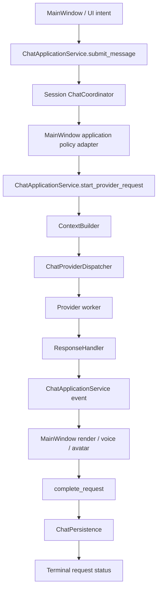

# Chat Application Service (TASK 006)

## Purpose and ownership

`kira/chat/application_service.py` is the application orchestration boundary for character chat sessions. It is Qt-free and composes existing feature contracts; it does not reimplement their internal behavior.

| Component | Owns |
|---|---|
| `ChatApplicationService` | Request identity, session-scoped lifecycle, orchestration order, cancellation, terminal cleanup, application events |
| `ChatCoordinator` | Per-session bounded FIFO admission and provider dispatch adapter |
| `ContextBuilder` | Prompt composition and immutable message/context snapshots |
| `ResponseHandler` | Provider event normalization, ordered chunk aggregation, exactly-once attempt terminal state |
| `ChatPersistence` / `ChatHistoryService` | Durable message/history writes, conversation identity and recovery |
| `ChatSearchService` | Message matching, filters, ranking, pagination and source references over the injected persistence reader |
| MainWindow adapter | UI rendering, voice/avatar effects, character/tool/search policy and construction of context input |

The service receives persistence, system-prompt composition, provider worker construction, dispatch/event callbacks, scheduling and cancellation through constructor injection. It owns one coordinator per session and one response lifecycle per provider attempt.

## Public API

- `get_or_create_conversation(session_id)` resolves the durable conversation bound to a character session.
- `submit_message(session_id, text, attachments, voice, conversation_id=...)` creates a request ID and submits an immutable request to the owning session queue, preserving conversation identity.
- `start_provider_request(request_id, context, provider_callbacks=..., **provider_request)` delegates prompt composition to ContextBuilder and provider worker creation to the session coordinator.
- `handle_provider_event(event)` routes request/session-scoped provider events through ResponseHandler. A successful provider attempt emits `PROVIDER_FINAL`; the application may retry an empty answer before completing the logical request.
- `complete_request(request_id, content, ...)` persists the final assistant message before emitting the completed lifecycle event.
- `complete_local_request(request_id)` closes a local/agent handoff that does not use the provider stream.
- `cancel_request(request_id)` forwards user cancellation to the provider adapter and closes the request exactly once, persisting partial output as `cancelled`.
- `get_request_status(request_id)` returns `pending`, `running`, `completed`, `failed` or `cancelled`.
- `dispatch_next(session_id, busy=False)` schedules the next FIFO item for only that session.
- `close_session(session_id)` cancels that session's pending/active requests and releases its coordinator.
- `dispose()` closes every session and rejects future submissions; active partial output is persisted once as `interrupted` during application shutdown.
- `persist_message`, `recent_messages`, `conversation_context` and `message_count` accept the session's `conversation_id`; `clear_history`, `restore_history` and `import_history` remain application-facing history operations. The UI does not call the persistence adapter directly.

All public request/event contracts retain both `request_id` and `session_id`; requests additionally retain the durable `conversation_id`. Provider attempts use internal attempt IDs so a permitted plain-prompt retry can reuse the logical application request without violating ResponseHandler's duplicate-terminal protection.

## Request flow

Provider chunk and terminal callbacks are pinned to the immutable attempt/session identity captured at worker creation. MainWindow supplies a Qt signal dispatcher from the session relay, so worker-thread callbacks are marshalled to the GUI thread before ResponseHandler or UI observers run. The application service itself remains Qt-free. The service rejects mismatched, late and duplicate terminal events. The completed response is persisted before the completed event is published. Failed/interrupted/cancelled partial content is persisted with its corresponding status; a persistence failure is exposed in the application event and the service outcome rather than being silently treated as a durable write. Application shutdown uses the service-owned cancellation/persistence path and records partial output as `interrupted`; explicit user cancellation remains `cancelled`. MainWindow does not write the same partial stream a second time.

## Session isolation and concurrency

- A coordinator and active logical request slot are maintained per session.
- Each character session is bound to one stable persisted conversation ID; submit, history reads, context assembly and message writes carry that ID.
- A queued request cannot overtake earlier queued work.
- One session can complete while another session remains active.
- Changing the visible tab does not alter the request's captured session ID.
- Closing a session cancels only its own requests and clears only its own queue.
- Terminal state transitions are guarded so duplicate provider callbacks cannot persist or publish twice.
- Request history is bounded; active requests are not pruned.

## MainWindow responsibilities still present

This is an incremental extraction, not the removal of the legacy window. MainWindow remains the UI/application-policy adapter for:
- input validation that depends on the current UI, attachment tiles and voice capture;
- Coding Agent interception and confirmation commands;
- game/Vision attachment policy;
- web/image search policy and search-worker lifecycle;
- Memory, Mood, Character profile, Brain and Tool Agent enrichment;
- creation of the data snapshot passed to ContextBuilder;
- UI stream painting, speech, avatar/body reactions, status badges and local command presentation.

MainWindow no longer imports or invokes ChatCoordinator, ContextBuilder, ResponseHandler or the persistence service directly. It calls ChatApplicationService for submission, provider start, message persistence, history access, cancellation and queue draining. Tool Agent execution and web-search workers remain separate application capabilities; they are not hidden inside ChatApplicationService.

## Search boundary

Chat-history search is implemented by `ChatSearchService` in `kira/chat/search.py`, not by this orchestration service or MainWindow. Consumers inject the `ChatPersistence` facade as its repository reader; the search service owns matching and result shaping while persistence retains durable reads. See [CHAT_SEARCH_RETRIEVAL.md](CHAT_SEARCH_RETRIEVAL.md) for the request/result contract and usage.

## EventBus policy

The request/response path uses direct service methods and the injected event callback. EventBus is not used as a universal call router. Broadcast notifications may continue to use EventBus independently.

## Validation

The focused suite is `python -m unittest tests.test_chat_application_service tests.test_chat_application_wiring tests.test_chat_coordinator tests.test_chat_context_builder tests.test_chat_response_handler tests.test_chat_persistence_contract -v`. The tests are pure Python and do not require QApplication, Qt, Windows or GUI interaction. The same modules are included in the portable regression workflow. Broader history and character-session regressions should also be run where the environment permits.
